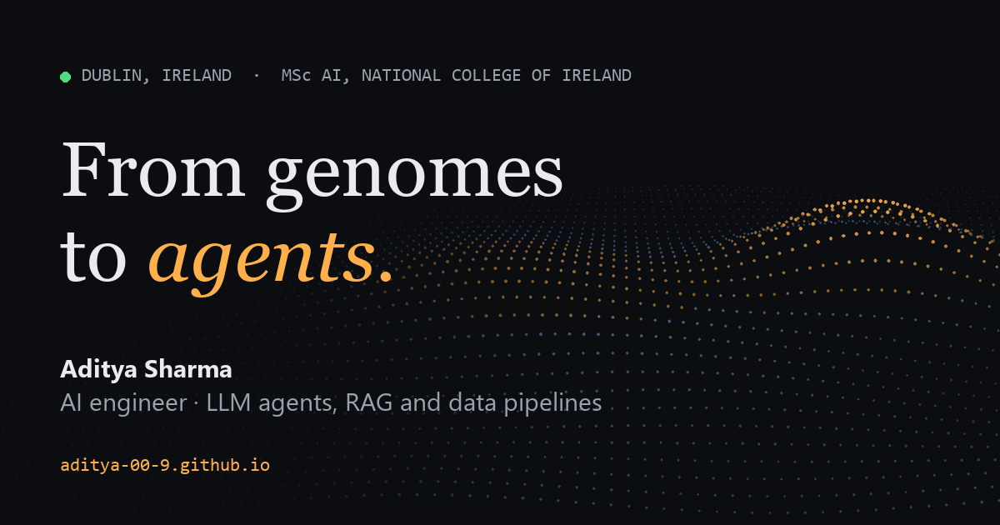

# aditya-00-9.github.io

My portfolio site, live at **[aditya-00-9.github.io](https://aditya-00-9.github.io)**.

I'm Aditya Sharma, an AI engineer and MSc AI student at the National College of Ireland in Dublin. I build LLM agents, retrieval systems and data pipelines, and I came to AI through bioinformatics research at IIT Bombay.



## What's on the site

- **Projects:** IntelliCredit (5th of 7,700+ at the IIT Hyderabad National AI/ML Hackathon 2026), Interview Buddy, Repositioning Intelligence, my p53 fitness-landscape thesis, carefully, and a lead intelligence pipeline, with links to code and live demos.
- **Experience:** Code Ninjas HQ, Ambarnath Transformers & Electricals, IIT Bombay, D.Y. Patil University and NullClass.
- **Toolkit, education and contact.**

## How it's built

Plain HTML, CSS and JavaScript: no framework, no build step, nothing to install.

- `index.html`: all content
- `assets/css/style.css`: light and dark themes from one set of colour tokens
- `assets/js/main.js`: theme toggle, project filter, scroll reveals and the hero animation (a dotted terrain with two peaks, a nod to the two-peaked fitness distribution in my thesis)
- `404.html`, `robots.txt`, `sitemap.xml`, `favicon.svg`, and an Open Graph image for link previews

It respects `prefers-reduced-motion` and `prefers-color-scheme`, and works without JavaScript.

## Run it locally

```bash
python -m http.server 4173
```

Then open http://localhost:4173.

## Deploy

GitHub Pages serves the `main` branch of this repository from the root. Push to `main` and the site updates within a minute or two.
